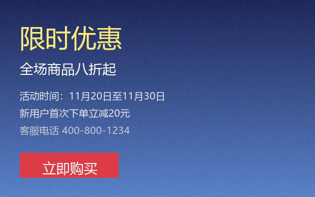

# imgtrans

把图片里的文字替换成目标语言，并**沿用原图的版式**：字号、位置、对齐、颜色、描边、倾斜、竖排都从原图反推，而不是套模板重新排版。

面向"文字嵌在图里"的场景——电商详情页、参数表、海报、banner。输出是替换过文字的图片，同时返回每块的原文与译文，可直接落库做双语对照。

<p align="center">
  
  
</p>

标题的字号与位置、黄色强调色、红色按钮内的白字都沿用原图；背景渐变与纹理无缝衔接，没有补丁边界。这两张图就是下面第一条命令的输入与输出。

## 流水线

七个阶段，每个阶段最关键的那处取舍见下表：

```
OCR → 段落聚合 → 翻译 → 遮罩 → 擦除 → 样式分析 → 回填
```

| 阶段 | 做什么 | 关键取舍 |
|---|---|---|
| OCR | PaddleOCR 检测 + 识别 | 输出四点框（OBB），保留倾斜角与竖排方向 |
| 行内拼接 | 把检测器切成左右几块的**同一行**拼回一条 | 不拼的话整段会散成碎片，每块各自定字号、回填互相压字 |
| 段落聚合 | 同一栏、同方向的相邻块合并成段 | 翻译整段才有上下文；单字翻译质量明显更差 |
| 翻译 | Google / 百度双通道，35 个目标语言 | Google 免费 `web` 通道需能访问 Google；百度可直连，但标准版只有 28 个常见语种 |
| 遮罩 | 每块单独估背景色、前景色、边框 | 背景色选错会连带 mask、擦除、字色全错 |
| 擦除 | 纯色填充 → 平面拟合 → `cv2.inpaint` 三级降级 | 优先用能算出来的，算不出来才让 OpenCV 猜 |
| 样式分析 | 字号、颜色、描边、粗细、对齐 | 拿不准时返回保守值：宁可少还原，不要还原错 |
| 回填 | 4× 超采样绘制，LANCZOS 降采样，alpha 合成 | 直接按 1× 画，小字会糊成一团 |

## 快速开始

环境要求：Python 3.11 ~ 3.13（由 uv 托管，本机不需要预装）、能访问 Google 的网络出口。

```bash
# 1. 装 uv（已装则跳过）
curl -LsSf https://astral.sh/uv/install.sh | sh        # Linux / macOS
powershell -c "irm https://astral.sh/uv/install.ps1 | iex"   # Windows

# 2. 建独立环境：CPU 或 GPU 二选一，必须显式指定
uv sync --extra cpu
# uv sync --extra gpu      # 需要 NVIDIA 驱动 >= 570（cu129 源，含 Blackwell sm_120）

# 3. 配置（Windows 上把 cp 换成 copy）
cp .env.example .env
# 编辑 .env，至少填 IMGTRANS_API_KEY（不填则服务拒绝启动）

# 4. 自检：依赖、raqm、字体、推理设备、鉴权与代理配置逐项过一遍
uv run python scripts/doctor.py

# 5. 启动
uv run python scripts/serve.py --port 8000
```

首次启动会下载 OCR 模型到 `.models/`（项目内目录，删项目即清干净），并预热模型——之后第一个请求才不会撞上 6~8 秒的加载。

> **为什么用 uv**：这条链路的依赖有两处硬约束——`paddlex` 要求 `numpy<2.4`，`paddlepaddle` 只发 `cp39`~`cp313` 的 wheel。装错时报错信息指向的往往是别的地方，很难定位。`uv.lock` 把解析结果锁死，`uv sync --frozen` 能在另一台机器上装出完全相同的环境。仓库里的 `requirements*.txt` 是历史遗留的 pip 路径，不再是真源。

## 配置

全部通过环境变量或 `.env`，优先级：**命令行 > 环境变量 > `.env`**。

| 变量 | 默认 | 说明 |
|---|---|---|
| `IMGTRANS_API_KEY` | 无 | 调用方需带 `X-Api-Key` 或 `Authorization: Bearer` |
| `IMGTRANS_PROXY` | 空 | 访问 Google / 下载图片用的代理，服务器能直连则留空 |
| `IMGTRANS_HOST` / `IMGTRANS_PORT` | `127.0.0.1` / `8000` | 监听地址 |
| `IMGTRANS_DEVICE` | `cpu` | `cpu` / `gpu` / `gpu:0` / `auto`（有卡用卡，无卡回落） |
| `IMGTRANS_TRANSLATOR` | `web` | `web`（免费通道，机房 IP 易被 429）/ `cloud`（官方 v2，需 Key）/ `baidu`（百度通用文本翻译） |
| `IMGTRANS_GOOGLE_KEY` / `_CREDENTIALS` / `_PROJECT` | 空 | `cloud` 通道凭证 |
| `IMGTRANS_BAIDU_APPID` / `_SECRET` | 空 | `baidu` 通道凭证。APP ID 是**纯数字**，密钥是另一串，混填报 `54001` |
| `IMGTRANS_BAIDU_QPS` | `1` | 百度标准版只有 1 QPS，高级版可设 10 |
| `IMGTRANS_BAIDU_PROXY` | 空 | 百度通道专用代理。**不继承** `IMGTRANS_PROXY`（那是给 Google 出海用的） |
| `IMGTRANS_BAIDU_PREMIUM` | `0` | 是否企业尊享版。留 `0` 时 11 个非常用语种（tr/id/hi/ka/uk/he/hr/sl/ms/no/bn）在入口即被拒并说明原因；开通尊享版后设 `1` |
| `IMGTRANS_ERASE_RESIDUALS` | `1` | 擦除后的框边残墨复检。字形溢出 OCR 框 1~2px 时能补掉，横贯的表格线不会被误伤；只在排错时关掉对照 |
| `IMGTRANS_OCR_PROFILE` | `quality` | `quality` / `fast`（只换检测模型，CPU 上快一倍，见下） |
| `IMGTRANS_OCR_DET_SIDE_LEN` | 空 | 检测长边上限，默认 736；调小约再快 15%，密集小字会漏 |
| `IMGTRANS_FONT_DIRS` | 空 | 额外字体目录，多个用 `;` 或 `:` 分隔 |
| `IMGTRANS_MODEL_DIR` | `.models` | 模型缓存位置，相对路径以项目根为基准 |
| `PADDLE_PDX_MODEL_SOURCE` | `bos`（安装脚本写入） | 模型下载源：`bos` / `huggingface` / `modelscope` / `aistudio` |

`fast` 档的检测模型是**额外下载**的。国内/香港机房从 HuggingFace 拉几 MB 的
`inference.pdiparams` 常超时，此时程序会**静默回退 `quality`**、接口照常 200，
只是永远不提速。所以安装脚本默认写入 `PADDLE_PDX_MODEL_SOURCE=bos`；排查时
看 `/healthz` 有没有 `ocr_fallback: true`，或日志里 `Creating model` 的模型名。

`.env` 里有真实密钥，已被 `.gitignore` 排除。仓库里只有 `.env.example`。

### 百度翻译通道

机房直连 Google 常吃 429（表现为接口 200 但图片还是中文），切 `baidu` 可以绕开：

```bash
IMGTRANS_TRANSLATOR=baidu
IMGTRANS_BAIDU_APPID=2023xxxxxxxxxxxxx   # 纯数字，不是密钥
IMGTRANS_BAIDU_SECRET=xxxxxxxxxxxxxxxxx
```

APP ID 与密钥都在「百度翻译开放平台 → 管理控制台 → 我的服务」里，同一行并列显示。
链接：<https://fanyi-api.baidu.com/manage/developer>

百度按请求里 `\n` 分行返回，每行带 `src` 原文，所以**一次请求就能翻完一张图的所有文本块**，
比免费 web 通道稳（不会被合并/拆句），往返次数从几十次降到一两次。
标准版限 1 QPS、单次 `q` 不超过 6000 字节，超了会拿到 `54003` / `54005`。

排错看两个地方：`/healthz` 的 `translator_last_error`（带错误码与中文解释），
以及日志里的 `circuit_open`。凭证类错误（`54001` 签名错、`52003` 未授权、
`54004` 余额不足、`58000` IP 白名单）连续 3 次会熔断 5 分钟——
改完配置要重启服务才会解除。

**`54001` 有两种含义**（实测确认）：签名错（APP ID 与密钥不配对），
或者该 APP ID 没开通通用文本翻译 / 没开通这个语言方向——百度在这两种情况下
回的是同一个码。先用 `apple` 试 `en→zh`（最容易通过的方向）：

```bash
IMGTRANS_BAIDU_SECRET=xxx python -m imgtrans.translator.cli \
  --kind baidu --appid 2023xxxxxxxxx --target zh --source en "apple"
```

返回译文说明凭证没问题，问题在语言方向；仍回 `54001` 基本就是密钥抄错了
（去 <https://fanyi-api.baidu.com/manage/developer> 重新复制整串）。

## 命令行

不起服务也能直接翻译，适合批处理与排查：

```bash
# 本地文件
uv run python scripts/translate_image.py --input tests/fixtures/demo_zh.png --to en --out out/demo_en.png

# 远程图片
uv run python scripts/translate_image.py --url https://example.com/a.jpg --to ja --out out/a_ja.png

# 只看识别与翻译结果，不出图
uv run python scripts/translate_image.py --input a.jpg --to en --dry-run
```

`--to` 取值见 `imgtrans/translator/lang_map.py` 的 `SUPPORTED_LANGS`（35 个，不含中文——中文是源语言）。

**语言码统一按 Google 风格传**（`ja` / `ko` / `fr` / `es` / `he`）。百度通道用的是另一套写法
（`jp` / `kor` / `fra` / `spa` / `heb`），服务内部会自己映射；如果你手边已有百度写法，
直接传也能用，两种写法完全等价，返回与日志里只会出现 Google 风格。

**百度通道的语言边界**：百度按账号档位切语言能力——个人标准版和高级版只有 **28 个常见语种**，
其余属"非常用语种"，要**企业尊享版**才翻得了。本项目 35 个目标语言里有 11 个属于后者：
`bn`（孟加拉）`he`（希伯来）`hi`（印地）`hr`（克罗地亚）`id`（印尼）`ka`（格鲁吉亚）
`ms`（马来）`no`（挪威）`sl`（斯洛文尼亚）`tr`（土耳其）`uk`（乌克兰）。

这 11 个语言在请求入口就会被拒（`E_LANG`），错误信息会写明是档位不够，而不是让 OCR 白跑
一趟再拿到百度的 `58001`。`/v1/languages` 也按当前通道的实际能力返回，被排除的语言列在
`excluded` 里并附原因。开通尊享版后设 `IMGTRANS_BAIDU_PREMIUM=1` 即放开。

## HTTP API

| 方法 | 路径 | 用途 |
|---|---|---|
| GET | `/healthz` | 探活，**免鉴权** |
| GET | `/v1/languages` | 返回支持的目标语言码 |
| POST | `/v1/translate/img` | **推荐接入**：JSON 入、JSON 出 |
| POST | `/v1/translate` | 老接口：URL 入、图片流出 |
| POST | `/v1/translate/upload` | 老接口：multipart 入、图片流出 |

```bash
KEY=$(grep '^IMGTRANS_API_KEY=' .env | cut -d= -f2)

curl -sS http://127.0.0.1:8000/v1/translate/img \
  -H "X-Api-Key: $KEY" -H "Content-Type: application/json" \
  -d '{"lang":"en","img":"https://example.com/a.jpg"}' \
  | jq -r .image_base64 | base64 -d > out_en.png
```

`img` 字段既可以是 `http(s)://` 地址，也可以是 base64（可带 `data:image/png;base64,` 前缀）。上限 20 MB。

响应固定为 JSON，除 `image_base64` 外还带 `blocks`（每块原文/译文/是否回填/字号/行数）与 `timings`（各阶段耗时），排查问题时不用再猜。完整字段与错误码见 [docs/api-usage.md](docs/api-usage.md)。

PHP 接入见 [examples/php/README.md](examples/php/README.md)。

## 目录

```
imgtrans/
  api/           FastAPI 应用：路由、鉴权、错误码
  ocr/           PaddleOCR 封装、段落聚合
  translator/    Google web / cloud 通道、tk 签名、语言码表
  inpaint/       mask（背景/字色/边框估计）、erase（三级擦除）
  render/        样式分析、字体选择、超采样绘制
  pipeline.py    串起全流程，产出报告
scripts/
  serve.py           启动服务
  translate_image.py 单图翻译（命令行）
  doctor.py          部署自检
  verify_live.py     翻译通道在线探针
  render_lab.py      回填沙盘：合成图集，秒级出图
  render_eval.py     回填几何评估：把"像不像"量化
  fidelity_report.py 版式自检：一张图量出聚合判据与缩放一致性
tests/         300+ 个用例，按模块分文件
deploy/        systemd unit、install.sh、nginx conf
docs/          技术设计、部署、API、Go 重写方案
```

## 开发与验证

```bash
# 全部用例
uv run python -m unittest discover -s tests -t . -q

# 回填沙盘：18 个合成场景（渐变、照片、描边、倾斜、竖排、密集表格…）
uv run python scripts/render_lab.py            # 出图到 out/lab/
uv run python scripts/render_eval.py           # 打印几何指标，有偏差会标出来

# 某张图上聚合判据到底取了什么值、缩放后是否还一致（不调翻译，不写文件）
uv run python scripts/fidelity_report.py --input a.png

# 翻译通道是否真的可用（单测只证明逻辑对，不证明 Google 接受签名）
uv run python scripts/verify_live.py
```

回填这块为什么单独做沙盘：完整链路一次要 60 秒以上，且每次输入都不同，没法稳定复现某一种排版失败。沙盘直接构造 `TextBlock`，只跑"擦除 → 样式 → 回填"，秒级出图、场景可控，`render_eval.py` 再把倾斜角、字号比、中心偏移量成数字——人眼看图容易漏，也难做回归。

段落聚合同理，走的是**生成版式**：`tests/test_layout_generalization.py` 自己画版式（行距、段间距、字号、段内行数、栏数），所以每块属于哪一段是已知真值，改判据就能立刻看出坏在哪组参数上，而不需要攒一堆真图来试。另有一条硬约束：同一版式放大缩小后段落划分必须一致——`fidelity_report.py` 把这条也做成了可执行检查。

## 部署

Linux 一键部署（Ubuntu 22.04 / 24.04，需 root）：

```bash
sudo bash deploy/install.sh --dry-run    # 先看会做什么
sudo bash deploy/install.sh              # 默认 /opt/imgtrans，端口 8000，CPU
sudo bash deploy/install.sh --gpu --user ocr
```

`--gpu` 会在下载任何东西之前先查驱动版本与磁盘空间（cu129 要求驱动 ≥ 570，磁盘 ≥ 10GB）。**别把源改回 cu126**：cu126 的 wheel 只编译到 sm_90，在 RTX 50 系列（Blackwell，sm_120）上能装、`is_compiled_with_cuda()` 返回 True，但一推理就 `no kernel image is available for execution on the device`。

脚本里每一条都对应一个真实踩过的坑：必须装 `libgomp1`（否则 `import paddle` 直接失败）、必须装三个字体包（缺了**不报错**，只是把译文画成一排方块并返回 200）、不能用 Alpine（paddle 只发 glibc wheel）、不能用系统 `python3`（22.04 自带 3.10，低于 `requires-python`）。

字体这块现在有两道自检，都不需要传图：

```bash
# 1) 启动日志（serve.py 装配完 pipeline 就打）
#    字体自检：35 个目标语言全部有字体覆盖
#    字体自检：2/35 个目标语言在本机画不出来（会渲染成方框）：
#      ka（georgian）：没有字体能画 'გამარჯობა'，缺 გამარჯობა

# 2) 部署巡检（按"这些字能不能真画出来"判断，不再只看文件名）
uv run python scripts/doctor.py
```

判据从"字体文件名对不对"改成"cmap 里到底有没有这些字形"，因为文件名猜不出覆盖：
`ka` 的候选里有 `DejaVuSans.ttf`，名字对得上，但如果那台机器上的版本没有格鲁吉亚字形，
照样一片方框。缺字体时先装 `fonts-noto-core`（含格鲁吉亚/泰/天城/孟加拉），重启即可。

### 一行里混了几种文字：按词回退

"找一个覆盖全的字体"这条路走不通：Noto Sans Bengali 有孟加拉文和数字，**没有 A~Z**；
Arial 有 A~Z，没有孟加拉文。所以任何非拉丁语言的译文，只要夹了品牌名、型号、单位
（`PTM7950`、`(PCM)`、`150°C`、`0.04℃cm2/W` 都是真实例子），用单一字体画必然在
一侧出方框——这不是挑错了字体，是无解。

所以绘制层按**词**（被空白隔开的一段）选字体：优先能覆盖整词的那个，找不到才退到
词内逐段兜底。按词而不是按字符，是因为逐字符会把一个整体切开——`PTM7950` 变成
`PTM`(拉丁)+`7950`(脚本字体)、`(PCM)` 变成"括号一种字体、字母另一种"、`150°C`
数字与单位分家；字都画得出来，但字距与字形风格对不上原文，比方框更难被察觉。

候选顺序是"主字体 → 该文字自己的族 → `_FALLBACK_ORDER`（latin → cjk → 其余）"，
逐段绘制、按**基线**对齐续接（不同字体的 ascent 不同，按 ascender 对齐会让拉丁字母
整体偏上/偏下几个像素）。词内兜底时按"能覆盖最长前缀的字体"贪心切分，尽量少切。

两条硬约束：
- 单字体能覆盖全行时仍是原来的一次性绘制，输出与以前逐像素一致（有测试钉住）。
- **组合记号（元音符号、声调）与 ZWJ/ZWNJ 绝不单独换字体**。它们离开基字后整形算不出
  连字，元音会跑到辅音右侧——字都在、拼写是错的。

### 字都在，但排错了：整形（Raqm）

字体覆盖只解决"有没有这个字"。孟加拉（`bn`）、天城（`hi`）、泰（`th`）、
阿拉伯（`ar`）、希伯来（`he`）还要**整形**：元音符号要挪到辅音的左侧或上下、
辅音之间要合成连字（`ক্ষ` 是一个字形），RTL 要从右往左排。这些 FreeType 不做，
只有 Pillow 的 Raqm 排版引擎（HarfBuzz + FriBiDi）会做。

缺 Raqm 时图上**每个字都在**，只是拼写是错的——接口照样返回 200，日志只有一条
UserWarning。中文用户看不出问题，当地人一眼就知道错。所以启动日志多了一行：

```
整形自检：Raqm 可用，复杂文字按 HarfBuzz 规则排版
整形自检：Pillow 没有 Raqm（缺 FriBiDi），5 个语言会排错：ar, bn, he, hi, th
  这些语言的元音符号位置、辅音连字、RTL 顺序都会不正确，但图上仍有字形（不是方框）。
```

修复（Ubuntu）：

```bash
apt-get install -y libraqm0 libfribidi0 && systemctl restart imgtrans
```

Pillow 是**运行时**才 dlopen 这两个库的（有的 wheel 静默内置、有的是动态链接，
本机实测 Pillow 13 的 win_amd64 wheel 导入表里同时有 `libraqm` 与 `fribidi`），
所以装完必须重启——整形能力只在启动阶段探测一次。Windows 上把 `libraqm.dll`
与 `fribidi-0.dll` 放进 `python.exe` 同目录。

代码上还有一处容易踩的坑：有 Raqm 时**不要**再手工做 RTL 重排。
`shape_rtl_text()`（arabic_reshaper + bidi）是没 Raqm 时的降级路径，
两条同时走会翻转两次，文字又倒回去。判定集中在 `shaped_for_paint()`。

手工部署与排障见 [docs/ubuntu-deploy.md](docs/ubuntu-deploy.md) 和 [docs/linux-deploy.md](docs/linux-deploy.md)。

### Google 通道报「两个通道均失败」

`E_TRANSLATE` 的 message 会按通道分别给出真实原因，**有状态码就报状态码，
没有就是连不上**（一个字节都没收到：超时、连接被重置、代理拒绝隧道）。
别看到这句话就去查限流——先看 message 里是哪种：

| message 里的样子 | 含义 | 怎么查 |
|---|---|---|
| `连接失败（ConnectTimeout…）` | 出口不通或代理不可达 | `curl -x <代理> -o /dev/null -w '%{http_code}' --max-time 10 https://www.google.com/generate_204` |
| `连接失败（…Connection reset…）` | 代理/安全组直接拒绝 | 确认代理白名单放行**本机出口 IP**（`curl -s ifconfig.me` 对一下） |
| `HTTP 429` | 出口 IP 被限流 | 免费通道 QPS 固定 4、不可配，只能换出口 IP 或切 `baidu` |
| `HTTP 403` | 被判定为机器人（TKK 轮换也会导致） | 换出口 IP，或改用付费 `cloud` 通道 |

message 末尾会带 `代理 http://…` 或 `未配置代理（直连）`，`/healthz` 的
`translator_proxy` 也给出**实际生效**的代理（不是 `.env` 里的配置值），
两者对不上就是配置没被通道采纳——百度通道只认 `IMGTRANS_BAIDU_PROXY`。

## 已知限制

这些是当前实现的真实边界，接入前值得知道：

- **翻译依赖 Google**。免费 `web` 通道的签名依赖 Google 的 TKK 值，Google 轮换后所有请求会 403。`scripts/verify_live.py` 是唯一能提前发现的手段，建议 cron 每 10 分钟跑一次。
- **相邻的"标签：值"行会被并成一段**。段落聚合按栏宽与行距判断是否同段，同一列的连续短行很容易被判成一段，译文因此变成一句连续长句（首图里"活动时间 / 新用户 / 客服电话"三行就是这样），原有的逐行层次会被抹平。以 `2.` / `①` / `•` 开头的行一律算新段落起点，编号列表不会被这条规则串起来。
- **段内行距是从图里量出来的，量不出时退回保守判据**。相邻间距按行高归一化后，若明显分成两簇（断层 ≥ 0.35 倍行高、两簇各 ≥ 2 个样本），阈值取断层中点，并允许跨句号合并；若单峰但有一簇明显更紧，按"最紧那簇"取上限、但仍以句号定段末；样本不足或整张图都是段间距时，退回 0.90 倍行高 + 句号断段。所以"行距和段间距只差一点点"的版式（如 0.68 与 0.73）只能靠标点分，合并与否取决于上一行有没有句号。
- **多栏图按"各段各自生长"聚合**，不会再被左右交替的读序打断；但栏内出现通栏块（横跨两栏的标题）时，它可能与某一栏的行合并，取决于横向重叠比例。
- **行内拼接靠间隙比例判断，默认 0.45 倍行高**。检测器把一行切成两块时靠它拼回去；反过来说，同一行里并排且间隙小于该值的两个**独立标签**也会被拼成一句。排满参数表或标签密集的图，把 `--row-join-gap` 调小（如 `0.2`），或设 `0` 关掉。
- **缺字形时会换族，换不到就按词回退，再不行才报出来**。字体族原本只按语言码选
  （`ka` → georgian），机器上没有这套字时旧实现会回退到最"能用"的字体——中文字体对
  格鲁吉亚文零覆盖，Pillow 不报错，只把整段画成一模一样的 □，接口还返回 200。
  现在分三层：
  1. 渲染前用**译文实际用到的字符**核对 cmap，本族能画就用本族，否则按顺序换一个能
     全覆盖的族（日志说明换了谁）；
  2. 没有单一字体能全覆盖时——混排文本的常态，`PTM7950` 只有拉丁字体有、`বাংলা` 只有
     孟加拉字体有——把每行按**词**切成多段，各用各的字体，按基线对齐逐段续接。
     按词而不是按字符，是因为逐字符会把 `PTM7950` 拆成 `PTM`+`7950`、`(PCM)` 拆成
     "括号一种字体、字母另一种"，字都有但一个整体被拆成两截（bn/hi/th 都踩过）；
     词内实在没有单一字体能覆盖时，按"最长前缀"贪心切，并保证组合记号不离开基字；
  3. 所有字体都没有的字才写进 `blocks[].note`（"字体缺字形，这些字被画成了方框：…"）
     并在响应 `warnings` 里抬一条。所以看到方框时，先看这两处说了什么，再去装字体。
- **RTL 文本不做词级回退**。`ar`/`he` 的 bidi 重排必须以整行为单位，按字符切开会让
  视觉顺序彻底错乱，所以这两族的混排（阿拉伯译文里夹英文品牌名）仍可能出现方框，
  只能靠装一个覆盖更全的字体解决。
- **整形（Raqm）缺失时字形齐全、拼写错误**。`bn`/`hi`/`th`/`ar`/`he` 缺 Raqm 时不会画方框，
  而是元音符号站错位置、连字被拆开、RTL 整行反向——接口 200、日志只有一条 UserWarning。
  启动日志的"整形自检"那一行会点名受影响的语言；修复见上文（装 `libraqm0 libfribidi0` 后重启）。
  没有 Raqm 时 RTL 会退到 `arabic_reshaper`+`bidi` 手工路径，但它只覆盖阿拉伯/希伯来，
  孟加拉与天城文**没有等价降级方案**，只能装库。
- **照片背景上的大字**擦除仍走 TELEA 扩散，会留下可见的涂抹感。要根治得做 exemplar / PatchMatch 纹理合成，属于另一个量级的改动。
- **擦除后会自动复检框边**（`erase_residuals`，默认开）。OCR 框贴着字形，右括号/中文标点偶尔溢出框 1~2px，mask 盖不到就留一道黑线；复检按"与框外背景色差"补，只补小碎块，横贯整块的细线（表格分隔线、边框）会跳过。仍然有两种情况会漏：溢出超过 3px（复检环宽度），以及残墨与背景对比低于 24/255（肉眼基本不可见）。
- **竖排标点不旋转**。日文的 `。，` 应落在字符格右上，目前是正着画的。
- **同排相邻块可能字号不一致**。空间紧张时各自缩字号，`crowded_row` 场景实测会出现 19 与 26 并存。统一字号要牺牲"尽量填满"，暂按前者。
- **中文不能作为目标语言**，只能作为源语言。
- **粗描边**（超过 2px）的颜色与宽度估计不准，`_detect_stroke` 目前假设 1~2px。

## 文档

| 文档 | 内容 |
|---|---|
| [docs/image-translate-technical-design.md](docs/image-translate-technical-design.md) | 技术设计：每个阶段的算法与取舍 |
| [docs/api-usage.md](docs/api-usage.md) | 接口字段、错误码、集成注意事项 |
| [docs/implementation-notes.md](docs/implementation-notes.md) | 实现细节与踩过的坑 |
| [docs/ubuntu-deploy.md](docs/ubuntu-deploy.md) | 线上 Ubuntu 部署 |
| [docs/uv-isolated-deploy.md](docs/uv-isolated-deploy.md) | uv 隔离部署方案 |
| [docs/linux-deploy.md](docs/linux-deploy.md) | Linux 通用部署与排障 |
| [docs/go-rewrite-plan.md](docs/go-rewrite-plan.md) | Go 重写方案（评估稿，未实施） |
